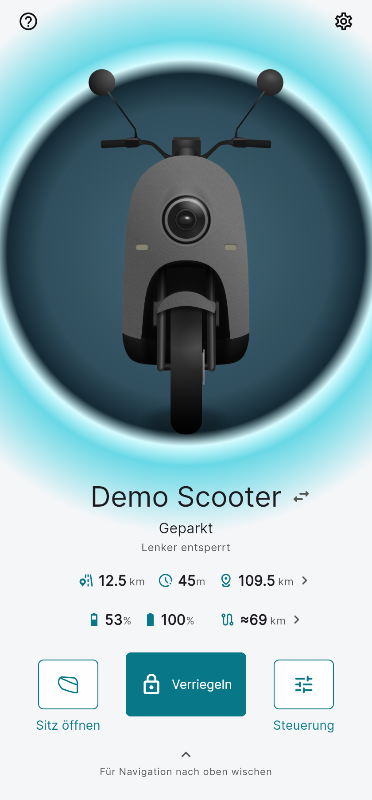
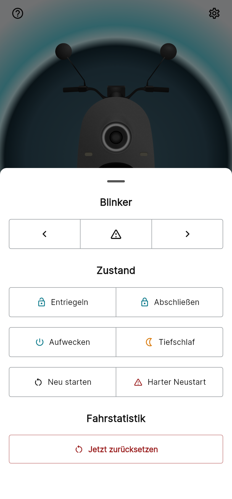
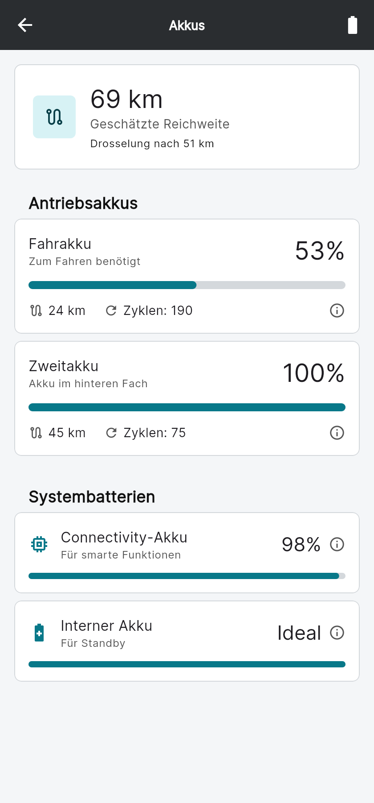
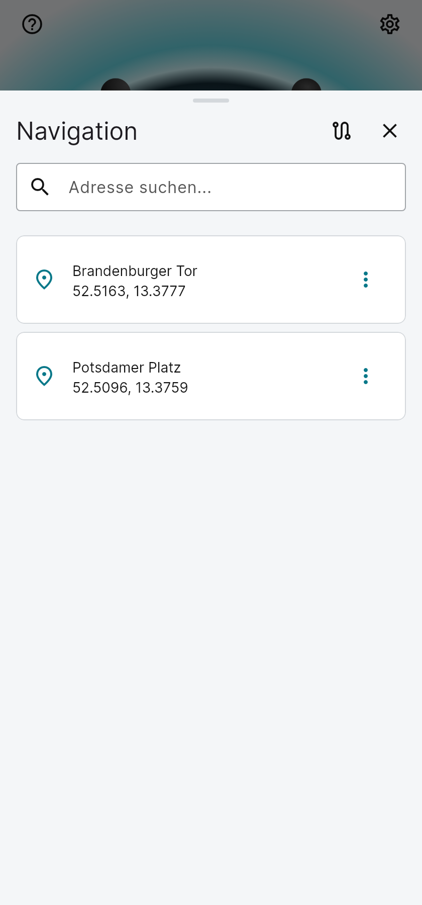
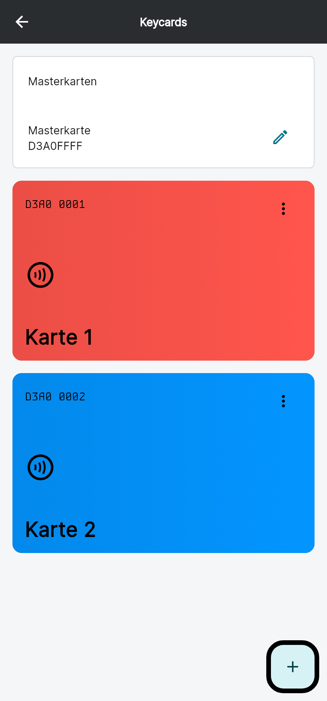
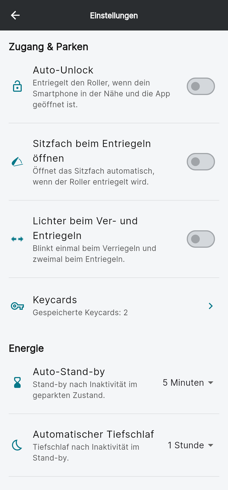
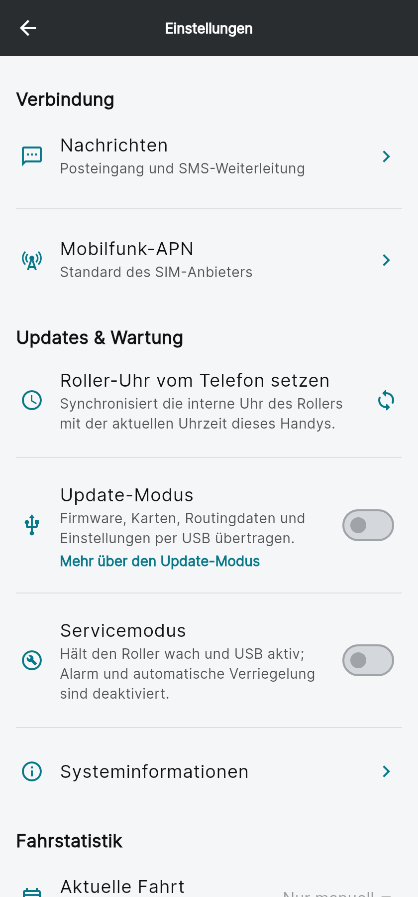

# Librescoot App for unu: Benutzerhandbuch

Dieses Handbuch beschreibt die Librescoot App for unu 1.3.3 für den unu Scooter Pro. Mit der App kannst du deinen Roller über Bluetooth verbinden, seinen Zustand ansehen und ihn bedienen. Viele Funktionen stehen nur mit Librescoot auf dem Roller zur Verfügung. Welche Einstellungen du siehst, hängt außerdem von der installierten Roller-Software und deinem Telefon ab.

Die Abbildungen zeigen die App-Oberfläche im Flutter-Test mit Demo-Daten, ohne System-Statusleiste. Sie zeigen keinen echten Roller. Darstellung und verfügbare Funktionen können auf deinem Gerät abweichen.

## Inhalt

1. [Vorbereitung und erste Verbindung](#vorbereitung-und-erste-verbindung)
2. [Startbildschirm und Roller bedienen](#startbildschirm-und-roller-bedienen)
3. [Roller verwalten](#roller-verwalten)
4. [Akkus, Reichweite und Fahrten](#akkus-reichweite-und-fahrten)
5. [Navigation](#navigation)
6. [Keycards und Android-Handyschlüssel](#keycards-und-android-handyschlüssel)
7. [Einstellungen am Roller](#einstellungen-am-roller)
8. [Firmware und Systeminformationen](#firmware-und-systeminformationen)
9. [App-Einstellungen und Datenschutz](#app-einstellungen-und-datenschutz)
10. [Widgets und Tasker](#widgets-und-tasker)
11. [Hilfe bei Problemen](#hilfe-bei-problemen)

## Vorbereitung und erste Verbindung

### Was du brauchst

- Einen unu Scooter Pro, der eingeschaltet und in Bluetooth-Reichweite ist.
- Ein Android-Smartphone oder iPhone mit installierter Librescoot App for unu und aktiviertem Bluetooth. Die Android-App findest du bei [Google Play](https://play.google.com/store/apps/details?id=org.librescoot.mobile.unu); iOS-Testversionen werden über TestFlight verteilt.
- Bei der ersten Kopplung Zugang zum Rollerdisplay, auf dem der Kopplungscode erscheint.
- Für manche Funktionen eine aktuelle, unterstützte Librescoot-Firmware auf dem Roller.

Die grundlegende Bluetooth-Steuerung benötigt kein Cloud-Konto. Für Downloads, Online-Ortssuche und externe Hilfeseiten braucht dein Telefon eine Internetverbindung.

### Berechtigungen

Beim ersten Start führt dich die App durch die Berechtigungen. Erlaube die Bluetooth- beziehungsweise „Geräte in der Nähe“-Berechtigung, damit die App den Roller finden und verbinden kann. Auf älteren Android-Versionen kann die Bluetooth-Suche zusätzlich die Standortberechtigung benötigen.

Standort und Benachrichtigungen sind auf aktuellen Geräten grundsätzlich optional. Standort wird beispielsweise für den letzten bekannten Verbindungsort und für Entfernungen zu Werkstätten verwendet. Benachrichtigungen werden insbesondere für die Android-Hintergrundverbindung gebraucht. Du kannst Berechtigungen später in den Systemeinstellungen deines Telefons ändern.

Die App fragt außerdem nach **Online-Standortdiensten**. Wenn du sie einschaltest, nutzt die Ortssuche externe Dienste. Du kannst die Auswahl später unter **Einstellungen > App > Online-Standortdienste** ändern.

### Roller koppeln

1. Öffne die App, wähle **Los geht's** und folge den Schritten zu Berechtigungen und Online-Standortdiensten.
2. Stelle dich mit dem Telefon neben den eingeschalteten Roller und starte die Suche.
3. Wähle deinen Roller aus der Liste. Die Liste zeigt unter anderem Signalstärke und Kopplungsstatus.
4. Bestätige die Kopplungsanfrage des Telefons. Der Code erscheint auf dem Rollerdisplay. Falls mehrere Anfragen erscheinen, bestätige die zu deinem Roller gehörenden Anfragen.
5. Vergib einen Namen und wähle eine Farbe. Danach erscheint der Roller auf dem Startbildschirm.

Wenn die App den Roller nicht findet, prüfe Bluetooth, Berechtigungen, Stromversorgung und Entfernung. Andere Apps, die gleichzeitig eine Hintergrundverbindung zum selben Roller aufbauen, können stören.

## Startbildschirm und Roller bedienen

Auf dem Startbildschirm siehst du den Rollernamen und den gemeldeten Zustand. Je nach Roller und Firmware zeigt die App außerdem Fahrtenzähler, Kilometerstand, Akkustände und eine geschätzte Reichweite. Tippe auf die jeweiligen Anzeigen, um mehr Informationen zu öffnen. Ein Pfeil neben dem Rollernamen führt zur Rollerübersicht.

Unten findest du die wichtigsten Aktionen:

- Entriegeln oder Verriegeln: die mittlere Taste gedrückt halten. Der Rollerzustand ändert sich nach einer erfolgreichen Anfrage. Entriegeln gibt auch die Lenkersperre frei und ermöglicht den Fahrbetrieb.
- Sitz öffnen: die Taste gedrückt halten, um das Sitzfach zu öffnen.
- Steuerung: weitere Aktionen wie Aufwecken, Tiefschlaf, Neustart und Blinker öffnen.
- Navigation: am unteren Bildschirmrand nach oben wischen.

Prüfe den angezeigten Rollerzustand nach einer Aktion. Bei offenem Sitzfach kann die App beim Verriegeln eine zusätzliche Bestätigung anbieten; der Roller kann dennoch auf das Schließen des Sitzfachs warten. Die Lenkersperre ist ein eigener Mechanismus: Ihr Status wird getrennt angezeigt. Wenn sie nicht wie erwartet einrastet oder freigibt, befolge die Hinweise der App und bewege den Lenker in die dort angegebene Stellung.

### Weitere Steuerung

Unter **Steuerung** kannst du, je nach Zustand und Firmware, den Roller aufwecken, in den Tiefschlaf versetzen, neu starten und Blinker oder Warnblinker bedienen. Ein harter Neustart unterbricht die Stromversorgung der betroffenen Systeme. Nutze ihn nur, wenn der Roller sicher steht und dafür bereit ist. Ein Aufwecktimer für den Tiefschlaf ist nur verfügbar, wenn die Roller-Software ihn unterstützt.

## Roller verwalten

Tippe auf dem Startbildschirm auf den Rollernamen. In der Übersicht kannst du mehrere gespeicherte Roller auswählen und über die Rolleraktionen verwalten:

- Verbinden oder Trennen;
- Roller umbenennen und die Darstellung beziehungsweise Farbe ändern;
- Auto-Connect für den einzelnen Roller ein- oder ausschalten;
- einen Roller aus der App entfernen oder einen weiteren hinzufügen.

Der Rollername und die Darstellung sind Einstellungen der App. Ein gespeicherter Roller kann auch ohne aktive Verbindung ausgewählt und umbenannt werden. Rollerbezogene Befehle und Einstellungen benötigen eine Verbindung. Beim Entfernen eines Rollers musst du ihn für eine spätere Nutzung erneut einrichten; auf unterstützter Librescoot-Firmware wird auch die zugehörige Telefonkopplung am Roller entfernt.

## Akkus, Reichweite und Fahrten

### Akkus und Reichweite

Tippe auf die Akku- oder Reichweitenanzeige des Startbildschirms. Die App zeigt verfügbare Angaben zu Fahrakkus und internen Akkus. Die tatsächliche Ausstattung und die vom Roller gelieferten Werte bestimmen, welche Anzeigen erscheinen. Die Reichweite ist eine Schätzung und keine Zusage, wie weit du noch fahren kannst.

Je nach Gerät kannst du einen Akku auch per NFC auslesen: Wähle die entsprechende Funktion in der Akkuansicht und halte das Telefon an das Etikett auf der Unterseite des Akkus. Die Position der NFC-Antenne ist je nach Telefon unterschiedlich; bewege das Telefon bei Bedarf langsam über das Etikett.

### Fahrtenzähler und Fahrtverlauf

Auf kompatibler Librescoot-Firmware öffnet ein Tippen auf die Fahrtanzeige die **Fahrstatistik**. Dort findest du Strecke, Fahrzeit und Durchschnittsgeschwindigkeit des aktuellen Zählers. Du kannst den Zähler manuell zurücksetzen oder, wenn unterstützt, eine Rücksetzregel wählen. Das Zurücksetzen des Zählers löscht nicht den Fahrtverlauf.

Der **Fahrtverlauf** ist über die Fahrstatistik erreichbar und zeigt unterstützte aufgezeichnete Fahrten. Unter **Einstellungen > Fahrstatistik** kannst du, sofern der Roller es unterstützt, die Aufbewahrungsregel für den Verlauf ändern. Prüfe Lösch- und Aufbewahrungsoptionen sorgfältig, bevor du sie bestätigst.

### Akku-Registrierung

Die App kann Hinweise zur Identifikation eines Akkus anzeigen. Die gemeinsame Registrierung und E-Mail-Bestätigung sind erst verfügbar, wenn der zugehörige Dienst freigeschaltet ist. Eine gelesene Seriennummer allein bedeutet nicht, dass ein Akku registriert wurde.

## Navigation

Wische auf dem Startbildschirm nach oben, um **Navigation** zu öffnen. Auf unterstützter Librescoot-Firmware kannst du Ziele auswählen und an den Roller senden.

### Ziel suchen und starten

1. Schalte bei Bedarf unter **Einstellungen > App > Online-Standortdienste** die Online-Suche ein.
2. Öffne **Navigation** und gib eine Adresse oder einen Ort in **Adresse suchen** ein.
3. Wähle ein Ergebnis. Du kannst es speichern oder **Navigieren** wählen.
4. Folge den Navigationshinweisen auf dem Rollerdisplay. Über **Beenden** stoppst du die aktive Navigation.

Wenn du gerade nicht verbunden bist, kann die App ein Ziel zur späteren Navigation vormerken. Die App zeigt dann **Navigation ausstehend**; das Ziel wird beim Verbinden weitergegeben. Gespeicherte Ziele können auch als **Offline** gekennzeichnet sein. Standortnamen und Suchanfragen werden bei aktivierten Online-Standortdiensten an die genannten Anbieter übertragen.

### Gespeicherte Ziele und Routen

Gespeicherte Ziele lassen sich über ihr Menü umbenennen oder löschen. Unterstützt dein Roller Routenpläne, öffnet das Routensymbol den **Routenplan**. Dort kannst du Stopps hinzufügen, neu anordnen, überspringen oder entfernen und die Route löschen. Die App weist darauf hin, wenn eine Neuordnung die Route wieder am ersten Stopp beginnen lässt.

Du kannst auch einen Ort aus einer anderen App teilen. Wähle die Librescoot App im Teilen-Menü und prüfe das erkannte Ziel, bevor du navigierst.

### Letzter Standort

Die Standortansicht zeigt den letzten Ort, an dem die App mit dem Roller verbunden war. Das ist keine Live-Ortung und kein Diebstahlschutz. Für eine Standortaufzeichnung braucht die App die entsprechende Berechtigung des Telefons.

## Keycards und Android-Handyschlüssel

Öffne bei verbundenem, kompatiblem Librescoot-Roller **Einstellungen > Zugang & Parken > Keycards**. Die App liest die Liste vom Roller. Über das Menü einer Karte kannst du sie umbenennen, ihre Darstellung ändern oder sie entfernen.

### Neue Keycard hinzufügen

1. Aktiviere NFC auf dem Telefon und öffne **Keycards**.
2. Tippe auf **+** und halte die kompatible Karte an die NFC-Antenne deines Telefons.
3. Halte dieselbe Karte zur Bestätigung erneut an das Telefon.
4. Warte auf die Bestätigung, dass die Karte zum Roller hinzugefügt wurde.

Die App benötigt für das Hinzufügen eine Verbindung zum Roller. Wenn das Telefon keine Karte erkennt, prüfe NFC und bewege die Karte langsam über die Rückseite. Halte eine bereits funktionierende Karte als Ersatz bereit, bevor du Schlüssel entfernst.

### Android-Handy als NFC-Schlüssel

Ein kompatibles Android-Telefon mit aktivierter NFC-Kartenemulation und ein Roller mit entsprechender Librescoot-Unterstützung können einen Handyschlüssel verwenden. Die Einrichtung findest du ebenfalls unter **Keycards**:

1. Wähle **Handyschlüssel einrichten oder anzeigen** und aktiviere den NFC-Handyschlüssel in der App.
2. Halte die Masterkarte an den Leser am Roller, um den Anlernmodus zu starten.
3. Halte das entsperrte Telefon an den Leser und anschließend die Masterkarte erneut, um den Schlüssel zu speichern.
4. Für die spätere Nutzung müssen NFC eingeschaltet und das Telefon entsperrt sein.

Auf unterstützter Firmware zeigt die App angemeldete Handys an und kann sie entfernen. Entferne nicht den letzten funktionierenden Schlüssel, ohne eine andere Möglichkeit zum Zugang zu haben.

## Einstellungen am Roller

Öffne das Zahnrad auf dem Startbildschirm. Grau dargestellte Rollerfunktionen sind ohne Verbindung oder ohne Unterstützung durch die Roller-Firmware nicht bedienbar.

### Zugang und Parken

- Auto-Unlock entriegelt den Roller, wenn sich das Telefon nähert und die Voraussetzungen der App erfüllt sind. Die Distanz ist eine Schätzung aus der Bluetooth-Signalstärke und keine exakte Entfernung. Teste sie zunächst an einem sicheren Ort.
- Sitzfach beim Entriegeln öffnen und Lichter beim Ver- und Entriegeln sind zusätzliche Optionen für den ausgewählten Roller.
- Unter **Keycards** verwaltest du unterstützte Karten und Handyschlüssel.

Prüfe beim Abstellen, ob der Roller tatsächlich verriegelt ist. Auto-Unlock und eine aktive Hintergrundverbindung können dazu führen, dass der Roller beim Vorbeigehen erneut entriegelt wird.

### Energie und Alarm

Unter **Energie** kannst du, abhängig von der Firmware, die Zeiten für **Auto-Stand-by** und **Automatischer Tiefschlaf** einstellen. Auto-Stand-by betrifft Inaktivität im geparkten Zustand, der automatische Tiefschlaf Inaktivität im Stand-by. Ein unterstützter **geplanter Tiefschlaf** nutzt die Uhr des Rollers und läuft nur, wenn die angezeigten Bedingungen erfüllt sind. Die Roller-Uhr muss dafür synchronisiert sein.

**Hauptakku wach halten** hält den Fahrakku bei offenem Sitzfach aktiv. Unter **Alarm** lassen sich unterstützte Alarm- und Hupoptionen einstellen. Bei unterstützter Firmware kann der Alarm vorübergehend entschärft werden, ohne die Einstellung **Beim Verriegeln aktivieren** dauerhaft zu ändern.

### Mobilfunk-APN

1. Verbinde dich mit dem Librescoot-Roller.
2. Öffne **Einstellungen > Verbindung > Mobilfunk-APN**.
3. Gib den APN ein, den der Mobilfunkanbieter der Roller-SIM vorgibt, und tippe auf **Speichern**.
4. Falls ein eigener APN gesetzt ist, kannst du ihn mit **Löschen** entfernen. Der Roller verwendet dann wieder den Standard des SIM-Anbieters.

Der APN betrifft die Mobilfunkverbindung des Rollers, nicht die des Telefons. Er ist nur bei unterstützter Firmware verfügbar. Bei Unsicherheit frage den SIM-Anbieter nach dem korrekten Wert.

### Nachrichten und Servicemodus

Auf unterstützten Rollern findest du unter **Verbindung > Nachrichten** den SMS-Eingang und eine Option zum Weiterleiten neuer Nachrichten. Für Weiterleitungen können Mobilfunkkosten entstehen; die App nennt die geltenden Grenzen in der Ansicht.

Der **Servicemodus** hält den Roller wach und USB aktiv. Dabei sind Alarm und automatische Verriegelung deaktiviert. Schalte ihn nach der Wartung wieder aus. Nutze den **Update-Modus** nur für den vorgesehenen USB-Dateiaustausch und wirf das USB-Laufwerk am Computer sicher aus, bevor du den Modus beendest.

## Firmware und Systeminformationen

Unter **Einstellungen > Systeminformationen** zeigt die App, soweit verfügbar, die Versionen von Hauptplatine, Dashboard und Bluetooth-System. Mit **Versionen aktualisieren** liest sie die Angaben erneut. Offline angezeigte Daten können zwischengespeichert sein.

### Firmware über Bluetooth aktualisieren

1. Stelle den Roller sicher ab und verbinde das Telefon per Bluetooth. Halte es während der Übertragung in der Nähe und die App geöffnet.
2. Öffne **Systeminformationen > Firmware-Updates über Bluetooth** oder den Update-Eintrag unter **Updates & Wartung**.
3. Lass die App nach verfügbaren Updates suchen und lies Hinweise zu Kanal, Größe und ausgewählter Platine.
4. Starte einen angebotenen Schritt mit **Installieren** und warte auf den angezeigten Übertragungs- und Installationsstatus. Die App plant den nächsten Schritt anschließend neu.
5. Nach Abschluss der Übertragung kann die Installation auf dem Roller weiterlaufen. Falls die App dazu auffordert, verbinde dich erneut, um die Installation zu bestätigen. Ein installierter Schritt kann auf das Verriegeln und den Neustart warten.

Ein vollständiges Image und ein Kanalwechsel können über Bluetooth lange dauern. Folge den Hinweisen in der App und unterbrich nicht absichtlich eine laufende Installation. Ist der Bluetooth-Update-Dienst nicht verfügbar, zeigt die App eine Erklärung; dann ist gegebenenfalls ein anderer Update-Weg nötig.

Für Dateien auf dem Telefon gibt es auf unterstützten Rollern zusätzlich **Update aus Datei**. Die App zeigt, ob Dateien zunächst hochgeladen oder unmittelbar installiert werden. Verwende nur passende, vertrauenswürdige Firmware-Dateien.

## App-Einstellungen und Datenschutz

Im Bereich **App** der Einstellungen kannst du unter anderem Sprache und Design ändern sowie **App-Sperre** und **Online-Standortdienste** steuern. Die App-Sperre verwendet die auf deinem Telefon eingerichtete biometrische Authentifizierung, sofern verfügbar.

Der **Demo-Modus** zeigt Beispieldaten, ohne deine gespeicherten Roller zu verändern. Trenne zunächst einen verbundenen Roller, um ihn zu aktivieren. Zum Verlassen schaltest du den Demo-Modus in den Einstellungen wieder aus.

Die Android-**Hintergrundverbindung** ist als Beta gekennzeichnet. Sie kann mehr Telefonakku verbrauchen und bei Problemen eine erneute Kopplung erforderlich machen. Lies den Hinweis beim Einschalten. Die Einstellung **Akku-Optimierung ignorieren** kann Hintergrundfunktionen unterstützen; ob und wie sie wirkt, hängt vom Telefon ab.

Der lokale **Aktivitätsverlauf** protokolliert unterstützte Aktionen auf diesem Gerät. Du kannst das Speichern abschalten oder den Verlauf in der entsprechenden Ansicht löschen. Einzelheiten zur Datenverarbeitung und zu Online-Diensten stehen in der verlinkten Datenschutzerklärung.

## Widgets und Tasker

Auf unterstützten Android- und iOS-Geräten kannst du ein Librescoot-Widget über die Widget-Auswahl des Betriebssystems zum Startbildschirm hinzufügen. Es zeigt verfügbare Rollerinformationen und bietet je nach Plattform Aktionen. Für aktuelle Daten muss die Verbindung beziehungsweise die jeweilige Hintergrundfunktion verfügbar sein.

Unter Android kann Tasker unterstützte Aktionen wie Verriegeln, Entriegeln und Sitzfach öffnen auslösen. Öffne und speichere die jeweilige Tasker-Aktion, wenn die App eine Autorisierung verlangt. Automationen müssen zum gewünschten Roller und zur Umgebung passen. Prüfe nach einer Aktion den tatsächlichen Zustand am Roller.

## Hilfe bei Problemen

### Verbindung klappt nicht

- Prüfe, ob der Roller eingeschaltet und in der Nähe ist und Bluetooth am Telefon aktiv ist.
- Prüfe die Berechtigungen für Geräte in der Nähe beziehungsweise auf älteren Android-Versionen den Standortzugriff.
- Warte bei einem gerade gestarteten Roller, bis Bluetooth verfügbar ist, und starte die Suche erneut.
- Deaktiviere gegebenenfalls die Hintergrundverbindung anderer Roller-Apps.
- Bei verlorener Kopplung kann eine erneute Einrichtung nötig sein. Halte eine funktionierende Keycard bereit.

### Eine Einstellung fehlt oder ist grau

Verbinde den richtigen Roller und warte, bis die App dessen unterstützte Funktionen gelesen hat. Manche Einträge benötigen Librescoot oder eine bestimmte Firmware-Funktion. Eine ausgegraute Einstellung lässt sich nicht ändern, solange die notwendige Verbindung oder Unterstützung fehlt.

### Ortssuche fehlt

Prüfe **Einstellungen > App > Online-Standortdienste**. Bei ausgeschalteter Online-Suche zeigt die App statt des Suchfelds einen Hinweis an. Für die Suche muss außerdem das Telefon online sein.

### App stürzt beim Umbenennen ab

Auf manchen Android-Geräten kann die App beim Antippen eines Umbenennen-Textfelds abstürzen. Falls das passiert, sende nach einem Neustart einen Fehlerbericht und beschreibe Telefonmodell, Android-Version und die Schritte.

### Fehlerbericht senden

1. Öffne auf dem Startbildschirm das Fragezeichen und wähle unter **Hilfe & Info** den Eintrag **Debug-Protokolle senden**.
2. Lies den Hinweis und wähle **Fortsetzen**. Deine E-Mail-App öffnet einen vorbereiteten Bericht.
3. Beschreibe oberhalb der Trennlinie, was du tun wolltest, was passiert ist und wie sich der Fehler wiederholen lässt.
4. Prüfe E-Mail und Anhang auf Informationen, die du nicht teilen möchtest, und sende die Nachricht selbst ab.

Der Bericht kann App- und Gerätedaten, Einstellungen, aktuelle Diagnoseprotokolle und verfügbare Android-Absturzinformationen enthalten. Die App verschickt die E-Mail nicht automatisch. Die Seite **Hilfe & Info** enthält außerdem Handbuch, Fehlersuche, Community und Werkstattverzeichnis.
